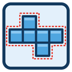

# JT Flat Layout

 

---

JT Flat Layout turns an assembled multi-body component into a flat 2D layout on the XY plane — ready for laser cutting — without taking the model apart by hand. Select the component, set the gap, click OK.

**Key features**
- Arranges every solid body of the selected component flat on the XY plane, side by side
- Laser kerf compensation: profiles are offset outward by the kerf you set
- Adjustable gap between panels
- Body names written on each panel, with adjustable text height
- Keep the original 3D bodies or leave only the flat layout
- Optional "Flat Layout" sub-component to keep the design tidy
- Export as DXF (native Fusion) or as multi-layer SVG: blue = outer cut, red = kerf/inner, black = labels — LightBurn-ready
- Delete the layout after export when you only need the file
- Editable Custom Feature in the timeline: change kerf, gap or options later and the layout updates
- Unlimited panels per layout

**Typical workflow**
1. Model your box or enclosure as a multi-body component
2. Click JT Flat Layout in the JTPLUGIN panel
3. Select the component, set kerf and gap
4. Tick Export as DXF or SVG if you want the file right away
5. Click OK — the flat layout is ready for the laser

A free Trial version (JT Flat Layout Trial) is available with a 5-panel limit, no kerf compensation and no SVG export.

---

📖 [Full Help & Documentation](https://jtplugin.github.io/fusion-flat-layout/help)

---

## Versions

| Feature | Pro | Trial |
|---------|---|---|
| Kerf compensation | ✅ | Fixed at 0 |
| SVG export | ✅ | Not available |
| Custom Feature wrap | ✅ | One-shot, not editable |
| Max panels per layout | Unlimited | 5 |

---

[Privacy Policy](https://jtplugin.github.io/privacy-policy) · [Terms of Service](https://jtplugin.github.io/terms) · [Support](mailto:jtplugin@ajl.vision)

---

*Plugin for Autodesk® Fusion® — developed by [JT Plugin Development](https://jtplugin.github.io)*
